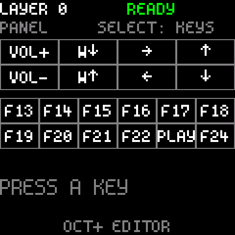
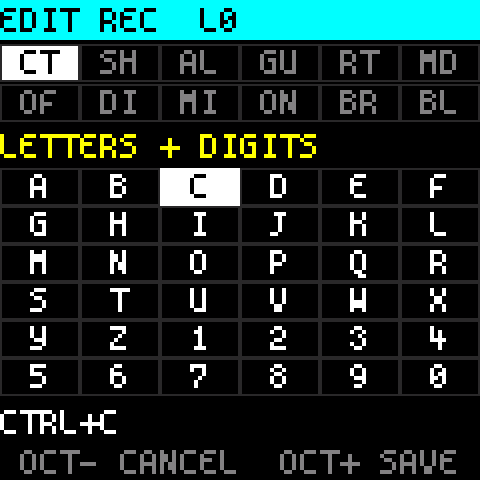
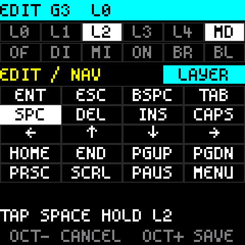
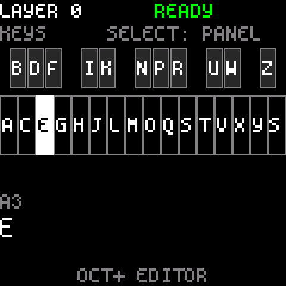
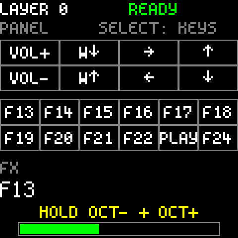
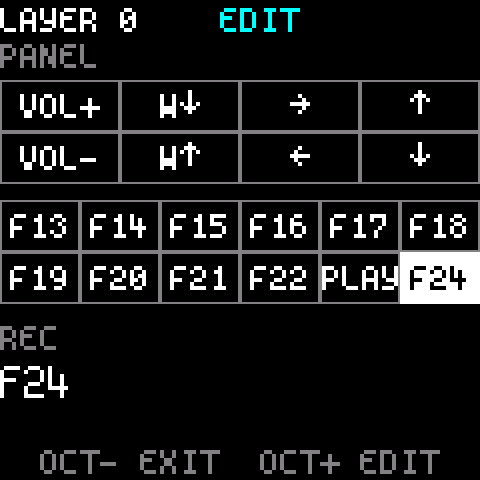

# Trireme FM-1

Custom firmware that turns the **M-VAVE FM-1** into a programmable USB keyboard and macro pad, configured with
[Vial](https://get.vial.today/) or directly on the device.

<p>



</p>

> **Unofficial.** Not affiliated with or endorsed by M-VAVE. Installing custom firmware is at your own risk. The FM-1
> can always go back to the stock firmware (see [Going back to stock](#going-back-to-stock)).

## What it does

- Every note key, button and the four right-hand knobs can send **any key**: letters, symbols, F-keys, numpad,
  arrows, shortcuts with modifiers (Ctrl+C, Alt+Tab, ...).
- **Media and mouse keys**: volume, play / pause, next / previous, mouse movement, buttons and wheel.
- **Five layers**, like any QMK keyboard: keys that switch layers while held, for one key press, or until pressed
  again; layer-tap (a key that types when tapped and switches a layer when held), mod-tap, one-shot modifiers.
- **Macros, tap dance, combos** and the QMK timing settings, edited in Vial.
- **Vial support**: the keyboard shows up in the Vial app and on [vial.rocks](https://vial.rocks) with its own
  layout; no definition file to load.
- **An on-device editor**: change any key, knob and light without a computer.
- **A live legend on the screen**: the FM-1's printed labels mean nothing as a keyboard, so the screen always shows
  what each control does on the current layer.
- **Per-key lights**: each button and key has a light style per layer (off, dim, mid, on, breathe, blink), or
  automatic (brighter for modifiers, layers and macros).
- The configuration is kept in the FM-1's flash and survives power cycles and reinstalls of the stock firmware.
- It stays a USB-MIDI device too, so the usual firmware installers keep working.

## Installing

1. **Install the stock V15 firmware first.** The FM-1 community's rule: always go back to stock V15 before
   installing a different custom firmware. Get it from M-VAVE (`FM-1.fwsc`) and install it with M-VAVE's updater or
   the installer below.
2. Download `fm1kbd-raw.fwsc` from the [Releases](../../releases) page.
3. Install it like any FM-1 firmware package. With felucca-bsp's installer (Python 3, `pip install mido
   python-rtmidi`; on Linux you may need `sudo` for MIDI access):

   ```sh
   python3 fm1_install.py fm1kbd-raw.fwsc
   ```

   The installer is in this repository at `third_party/felucca-bsp/tools/fm1_install.py`.
4. The FM-1 restarts as **FM-1 Keyboard**. The screen says `READY` when the computer has accepted it.

### Going back to stock

Install the stock V15 package the same way. The keyboard configuration stays in flash, untouched, for the next time.

If the firmware ever does not start: hold **OCT+** while powering on (or hold **OCT-** and **OCT+** together for
5 seconds while it runs). The FM-1 enters update mode and accepts any firmware package. After two failed starts in
a row it enters update mode by itself.

## The controls

<p>


</p>

| Control | What it does |
|---|---|
| Note keys, FX ... EDIT, GLO, HOME ... REC, KNOB1-4 | Yours to assign (keys, shortcuts, media, mouse, layers, macros, ...) |
| PRESETS | Switches the layer (0-4) |
| SELECT | Flips the legend between the buttons and knobs page and the note keys page |
| OCT+ | Opens the editor |
| OCT- + OCT+ held 3 s | Unlocks Vial, when Vial asks |
| OCT- + OCT+ held 5 s | Update mode |
| OCT- held at power-on | MIDI only: no keyboard on USB |
| OCT+ held at power-on | Update mode |

The screen shows the layer, the USB state and the legend. The last control you used is highlighted for two seconds
and its full meaning is shown below the legend.

### Default layout (layer 0)

| Controls | Keys |
|---|---|
| Note keys, lowest to highest | A ... Z, then Space |
| FX ... REC (12 buttons) | F13 ... F22, PLAY = play / pause, REC = F24 |
| KNOB1 | Volume |
| KNOB2 | Mouse wheel |
| KNOB3 | Left / right arrow |
| KNOB4 | Down / up arrow |

Layers 1-4 start empty: every control falls through to layer 0.

## Configuring with Vial

Open the [Vial app](https://get.vial.today/) or [vial.rocks](https://vial.rocks) in Chrome or Edge with the FM-1
connected. It finds **FM-1 Keyboard** and shows its layout. Everything is saved to the FM-1 a few seconds after the
last change.

To change macros (or assign the bootloader key), Vial asks to unlock the keyboard: hold **OCT-** and **OCT+**
together for 3 seconds (a bar fills on the screen).



On Linux, Vial needs a udev rule to see the keyboard (the standard one from the
[Vial docs](https://get.vial.today/manual/linux-udev.html)):

```sh
export USER_GID=`id -g`; sudo --preserve-env=USER_GID sh -c 'echo "KERNEL==\"hidraw*\", SUBSYSTEM==\"hidraw\", ATTRS{serial}==\"*vial:f64c2b3c*\", MODE=\"0660\", GROUP=\"$USER_GID\", TAG+=\"uaccess\", TAG+=\"udev-acl\"" > /etc/udev/rules.d/99-vial.rules && udevadm control --reload && udevadm trigger'
```

The FM-1's own functions are custom keycodes in Vial's **User** tab: LAYER- and LAYER+ (step through the layers)
and KB OFF (stops sending keys to the computer; press it again to turn them back on).

## The on-device editor

Press **OCT+**. The hint line at the bottom always says what OCT- and OCT+ do next.

**1. Choose a control.** Press any key or button, or turn a knob in the direction you want to change. It is
highlighted and its current meaning is shown. **PRESETS** picks the layer to edit. **SELECT** picks what to do with
it:

| Action | What it does |
|---|---|
| EDIT | Change it (the default) |
| COPY / SWAP | Copy it to, or swap it with, another control |
| CLEAR | Make it empty (falls through to the layers below) |
| DEFAULT | Back to the default layout |
| COPY LAYER / CLEAR LAYER | The whole layer at once |
| INFO | Firmware version, the number of saves, the configuration size |
| LED TEST | Every light on |

**OCT+** does it, **OCT-** leaves the editor.



**2. Edit it.** The screen becomes a grid of values:

- **PRESETS**: the category (letters and digits, symbols, edit / navigation, F-keys, numpad, media, mouse, layers,
  macros, tap dance, FM-1, ...).
- **SELECT**: moves up and down through the grid (and its pages).
- **ALGORITHM**: moves across.
- The white note keys jump straight to a page of the grid; the lit ones have a page.

The buttons become tools, labelled in the two strips at the top of the screen:

| Buttons | In the editor |
|---|---|
| FX SEL ENV LFO EDIT | Ctrl, Shift, Alt, GUI (Windows / Command key), Right (use the right-hand modifiers) |
| GLO | Mode: WITH (modifiers held with the key), HOLD (the key when tapped, the modifiers when held), ONE-SHOT (the modifiers apply to the next key), LAYER (the key when tapped, a layer when held: FX ... EDIT then pick layer 0-4) |
| HOME ... REC | Light: OFF, DIM, MID, ON, BREATHE, BLINK; press the selected one again for automatic |

The control's own light previews the light style you pick. The line under the grid says the result in words
("CTRL+C", "TAP SPACE HOLD L2"), or why a combination cannot be saved.

**OCT+** saves, **OCT-** cancels. Both go back to step 1.

<p>


</p>

**Layer keys** (category LAYERS): HOLD (the layer while the key is held), ONE-SHOT (for the next key press), GO TO
(switch to it), TOGGLE (switch to it until the same key is pressed again).

**What the editor cannot do**: write macros, tap dances and combos, or change the QMK timing settings. It can assign
existing macros and tap dances to keys; use Vial to write them. Anything set in Vial that the editor cannot show is
kept as it is.

## Building

You need Linux (or WSL), `make`, GCC (for the PC tests), Python 3, and:

- **The JieLi Linux toolchain**: [jieli-linux-toolchains](https://pkgman.jieliapp.com/s/linux-toolchain)
  (tested with 20250324.1). Unpack it; `TC` is the directory with `pi32v2/` and `common/` in it.
- **The JieLi AC79 SDK** (Apache-2.0), only for building the package: felucca-bsp's `tools/get_sdk.sh` fetches the
  tested revision into `~/.jieli/ac79-sdk`.

```sh
git clone --recursive https://github.com/ignis32/trireme_fm1
cd trireme_fm1
third_party/felucca-bsp/tools/get_sdk.sh             # the SDK, into ~/.jieli/ac79-sdk
make package TC=/path/to/jieli-linux-toolchains      # build/fw-raw/fm1kbd-raw.fwsc
make test                                            # the tests on the PC
make screens                                         # the screen pictures as PNGs (needs Pillow)
```

Put `TC := ...` and `AC79_SDK := ...` in a `local.mk` file to avoid typing them. The default `TC` is
`~/.jieli/toolchain`.

`make test` runs the USB descriptor checks, the key engine and Vial protocol tests, the flash storage tests
(including power cuts at every step of a save) and the screen and editor tests. With a checkout of
[vial-gui](https://github.com/vial-kb/vial-gui) in `refs/vial-gui` it also drives the firmware's Vial code with
vial-gui's own protocol code.

`FLAVOR=console` builds a variant with a USB serial console instead of Vial, for development.

### Layout

| Path | What |
|---|---|
| `firmware/main.c` | Boot, the main loop, LEDs, screen hooks |
| `firmware/kbcore.c` | The key engine (layers, tap / hold, combos, macros) and the Vial protocol |
| `firmware/store.c` | The configuration in flash (two copies, power-cut safe) |
| `firmware/editor.c`, `ui.c`, `gfx.c` | The on-device editor, the screens, the drawing |
| `firmware/usb.c` | felucca-bsp's USB driver with HID added (`patches/usb-hid.patch`) |
| `firmware/vial.json` | The Vial definition (built into the firmware) |
| `tests/` | The PC tests |
| `tools/` | Build helpers, `vialcli.py` (keys and macros from the command line) |
| `third_party/felucca-bsp` | The FM-1 board support (git submodule) |

## Licence and credits

GPL-3.0 ([LICENSE](LICENSE)). The firmware includes felucca-bsp's `usb.c`, which is GPL-3.0-only.

- [felucca-bsp](https://github.com/hugelton/felucca-bsp) by Leo Kuroshita / Hügelton Instruments (MPL-2.0, `usb.c`
  GPL-3.0-only), split out of [Felucca](https://github.com/hugelton/Felucca): chip and board support, the update
  loader, the package builder and installer.
- [Spleen](https://github.com/fcambus/spleen) fonts by Frederic Cambus (BSD-2-Clause, notice in
  `firmware/font.h`).
- Keycode numbers from [vial-qmk](https://github.com/vial-kb/vial-qmk) (QMK / Vial protocol).
- Firmware packages contain three files of the JieLi AC79 SDK (Apache-2.0); its licence text goes with every
  released package.
